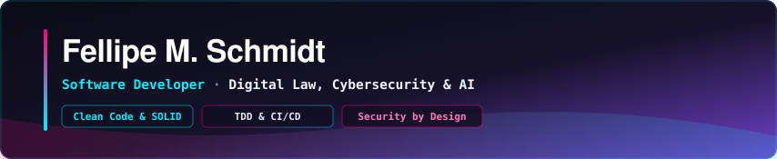

**Language / Idioma:** [Português (BR)](./README.md) · **English (EN)**

  

 

Software developer with a degree in Law, a postgraduate specialization in **Digital Law, AI & Cybersecurity**, and currently pursuing a degree in **Systems Analysis and Development**. I build web applications focusing on automated quality, clean architecture, information security, and governed AI-assisted development, translating data privacy, security, and complex business rules into clean, modular, and testable code.

---

### Tech Stack & Skills

  

---

### Engineering Practices

- **Architecture & Design:** Clean Code · SOLID · RBAC · ADRs
- **Quality:** TDD · Automated Testing · Static Analysis · CI/CD
- **Security & Privacy:** Security by Design · Privacy by Design · Audit Trails
- **AI & Governance:** Spec-Driven Development (SDD) · Cross-Model Review · Agent Orchestration
